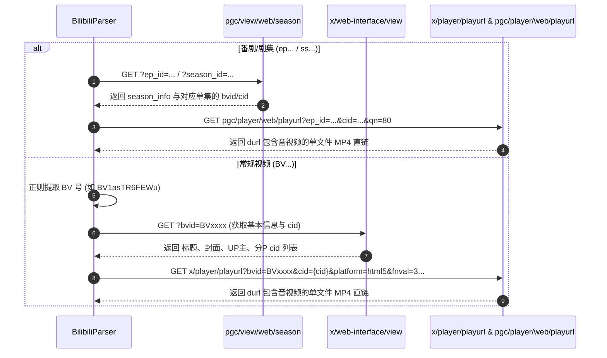

# 哔哩哔哩 (Bilibili) 逆向解析指南

本篇详细记录 B 站普通视频、番剧/影视剧集（Bangumi `ep...`/`ss...`）基本信息与可直接播放的单文件 MP4 播放流提取方案。

---

## 1. 平台特征与支持能力

* **平台标识**：`哔哩哔哩`
* **支持媒体类型**：
  * 高清视频流 (单文件 MP4)
  * 番剧/电影/纪录片剧集（Bangumi 预告与正片）
  * 高清封面图 (Cover)
  * 视频标题与 UP 主/官方账号信息
* **常见链接形态**：
  * 短链接：`https://b23.tv/xxxx`、`https://b23.tv/ep3372237`
  * 网页端长链 (BV/AV)：`https://www.bilibili.com/video/BV1asTR6FEWu`、`https://www.bilibili.com/video/av170001`
  * 番剧/剧集长链：`https://www.bilibili.com/bangumi/play/ep1231565`、`https://www.bilibili.com/bangumi/play/ss12345`
  * 动态/Opus 链接：`https://t.bilibili.com/1245189054385881096` 或 `https://www.bilibili.com/opus/1245189054385881096`
* **Cookie 依赖**：
  * **完全免 Cookie**：免登录直接获取 720P/1080P HTML5 基础流、番剧预告/公开剧集及图文动态。

---

## 2. 核心逆向流程：双 API 联动

Bilibili 解析采用官方公开的 Web 开放接口进行两步联动查询：



### 2.1 步骤 1：获取视频/番剧详情与 `cid`
* **常规视频**：支持 BV 号（`https://api.bilibili.com/x/web-interface/view?bvid={bvid}`）与旧版 AV 号（`https://api.bilibili.com/x/web-interface/view?aid={aid}`，如 `/video/av170001` 或 URL 中的 `aid=...`）；
* **番剧剧集**：`https://api.bilibili.com/pgc/view/web/season?ep_id={ep_id}`；
* **产出**：获取视频的标准 `bvid`、`cid`（内容分块 ID）、`title`、`pic`/`cover`（封面图）、`owner`/`up_info`（UP主）。

### 2.2 步骤 2：获取无需合成的单文件 MP4 流 (`PlayURL`)
* **常规视频**：`https://api.bilibili.com/x/player/playurl?bvid={bvid}&cid={cid}&platform=html5&fnval=3&qn=112`
* **番剧剧集**：`https://api.bilibili.com/pgc/player/web/playurl?ep_id={ep_id}&cid={cid}&qn=80&fnval=1`
* **数据提取**：直接从 `data.durl[0].url` / `result.durl[0].url` 获取已合并音视频的完整 MP4 直链，免去服务器端调用 `ffmpeg` 转码的性能开销。

---

## 3. 常见踩坑记录 (Gotchas)

1. **DASH 格式音视频分流陷阱**：
   * 现代 B 站客户端默认使用 DASH（音轨与视轨分开为两个独立的 m4s 文件），如果直接提取会导致视频没有声音。
   * **解法**：如上述参数配置，强制指定 `platform=html5` 请求，B 站服务端会自动返回封装好的 Progressive MP4 单文件流。
2. **防盗链 (403 Forbidden)**：
   * 播放或下载 B 站视频直链时，客户端请求头中必须附带 `Referer: https://www.bilibili.com/`，否则会被 CDN 拦截。
3. **云服务器/机房 IP 触发 412 (Precondition Failed) 风控拦截**：
   * 在云服务器/数据中心（如 Docker 部署）环境下，使用 PC 浏览器（Chrome/Firefox 等）User-Agent 访问视频详情接口 `https://api.bilibili.com/x/web-interface/view` 会被 B 站 WAF 拦截并返回 `HTTP 412 Precondition Failed`。
   * **解法**：视频详情接口单独使用非浏览器/客户端标识（如 `okhttp/4.9.3`），即可绕过该 WAF 拦截正常获取视频信息。
4. **不可见/删除/付费等终态错误映射 (`MEDIA_DELETED_OR_PRIVATE`)**：
   * **稿件不可见/已删除**：B 站详情接口返回错误码 `62002`（稿件不可见）、`62004`、`-404`（啥都木有）；
   * **动态不可见/已删除**：动态接口返回错误码 `4101152`（动态不可见）、`4101153`；
   * **充电专属/付费视频**：接口返回错误码 `87008`（需购买充电专属视频）；
   * 解析器捕获上述状态码后会自动将错误提升并映射为 `MEDIA_DELETED_OR_PRIVATE` 终态错误，提示调用方内容不可查看，阻断客户端无意义重试。

---

## 4. 测试与验证

* **单元测试**：[tests/test_bilibili_parser.py](file:///Users/leo/Projects/media-parser/tests/test_bilibili_parser.py)
* **执行测试**：
  ```bash
  pytest tests/test_bilibili_parser.py
  python tests/manual_verify_parsers.py --platform 哔哩哔哩
  ```
