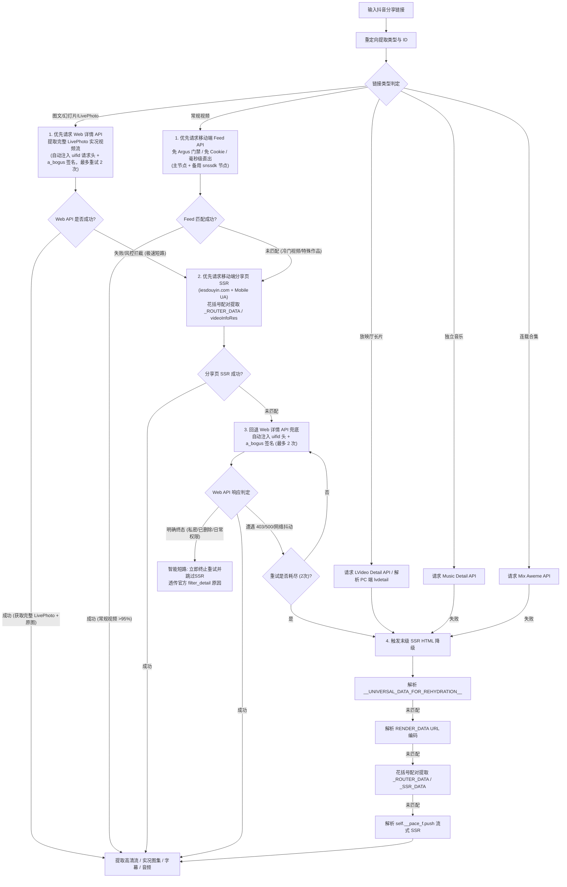

# 抖音 (Douyin) 逆向解析指南

本篇详细记录抖音平台短视频、图文笔记、LivePhoto 实况、独立音乐/原声、连载合集及原生 AI 字幕的完整逆向提取方案、签名机制、容灾降级策略及踩坑经验。

---

## 1. 平台特征与支持能力

* **平台标识**：`抖音`
* **支持媒体类型**：
  * 无水印高清视频 (智能码率排序，优先选取兼容性最好的 H.264 编码，无缝兼容 H.265/HEVC)
  * 放映厅 / 影视长片 / 连载短剧 / 剧场短片 (单集与全集列表 `video_list`，标题 `【放映厅】...` 或 `【短剧】...`)
  * 高清图文图集 (无水印原图)
  * 动态实况照片 (LivePhoto 动态视频流)
  * 背景音乐 / 独立原声 (Audio MP3)
  * 连载合集 / 短剧专题 / 短剧详情页 (多分集视频列表 `video_list`，支持 `/share/playlet/detail/<id>`)
  * 原生 AI 生成字幕 (WebVTT 格式，含多语言代码与字幕 ID)
* **常见链接形态**：
  * 短链接：`https://v.douyin.com/Nid-fFF_sdI/`
  * 移动网页端分享长链：`https://m.douyin.com/share/video/7685345542323834441`
  * 网页端放映厅长片长链：`https://www.douyin.com/lvdetail/7677129845654061595`
  * 网页端短剧详情长链：`https://www.douyin.com/share/playlet/detail/7604472147116556322` 或 `https://www.douyin.com/playlet/detail/...`
  * 网页端视频长链：`https://www.douyin.com/video/7616399587141737704`
  * 网页端图文长链：`https://www.douyin.com/note/7616399587141737704`
  * 网页端独立音乐长链：`https://www.douyin.com/music/7123456789012345678`
  * 网页端合集长链：`https://www.douyin.com/collection/7123456789012345678`
* **Cookie 依赖**：
  * **普通视频与普通图文 (100% 免配)**：完全无需用户登录 Cookie。常规视频直连**移动端 Feed 核心通道**（免 Argus 门禁、免 Cookie、免签名、毫秒级直出）；普通图文自动通过分享页 SSR 提取高清原图。
  * **LivePhoto 实况照片 (`live_photo_url`)**：实况视频流仅由 PC Web 详情 API (`/aweme/v1/web/aweme/detail/`) 下发。在云服务器（机房 IP）下受字节跳动严格风控，需在 `.env` 中配置 `DOUYIN_COOKIE`，且必须包含完整登录 Cookie（含 `sessionid`, `sessionid_ss`, `passport_csrf_token`, `odin_tt` 等）以及 `UIFID` 字段。解析器会自动计算 `x-secsdk-web-signature` 签名并注入 `uifid` 请求头，完美穿透网关阻断；若未配置或遭遇不可抗力风控，自动保底降级为全量静态无水印原图。
  * **放映厅长片 (`/lvdetail/`)**：受字节跳动严格风控保护，可在 `.env` 中配置人机滑块通行证 `DOUYIN_COOKIE="s_v_web_id=verify_..."`（代码已做路由隔离，常规作品会自动剔除过期验证码）。
* **环境变量控制**：
  * `DOUYIN_COOKIE`：实况 LivePhoto 视频流或特定风控页面所需的登录凭据与 UIFID。
  * `DOUYIN_ENABLE_MOBILE_FEED`：是否启用移动端 Feed 核心通道免风控直出（默认 `1` 启用）。
  * `DOUYIN_UNDER_REVIEW_MAX_AGE`：刚发布作品审核中状态判别窗口（秒，默认 `7200` 即 2 小时；处于该窗口内返回 `status_self_see` 视作 `MEDIA_UNDER_REVIEW` 审核中）。
  * `DOUYIN_API_MAX_ATTEMPTS`：Web 详情接口重试上限（默认 `2` 次）。

---

## 2. 链路追踪与 ID 提取

1. **302 重定向**：通过 `WebFetcher.fetch_redirect_url` 跟随短链 302 跳转至标准长链接，并保留 `ep_id`、`album_id` 等关键参数。
2. **ID 提取**：使用 `UrlParser.get_video_id` 自动从 `/video/`、`/note/`、`/music/`、`/collection/`、`/lvdetail/` 及 `ep_id` 参数匹配作品/分集 ID。

---

## 3. 核心逆向方案与多轨容灾机制

抖音解析采用 **图文/LivePhoto 优先 Web API (含实况视频流) + 常规视频移动端 Feed 免 Argus 主路径 + 移动端分享页 SSR 免签名次主路径/图文降级 + Web API 退避重试兜底 + SSR HTML 末级容灾 + 流式 SSR (RSC) 深度解析** 的异构高可用架构。



### 3.1 移动端 Feed 核心通道（常规视频主路径）
* **接口定义**：
  ```text
  主节点：https://api5-normal-c-hl.amemv.com/aweme/v1/feed/?aweme_id={aweme_id}&aid=1128
  备用节点：https://aweme.snssdk.com/aweme/v1/feed/?aweme_id={aweme_id}&aid=1128
  ```
* **核心优势**：
  * **绕开 Argus 门禁**：走移动端 App 推荐流协议，不经过 PC Web 端的 `ArgusSecurityPlugin`；
  * **零风控依赖**：无需 `UIFID`、`x-secsdk-web-signature`、`a_bogus`、`msToken` 或任何 Cookie；
  * **高性能与高可用**：测试中常规视频 403 率为 0%，端到端耗时仅约 200ms；支持主备节点智能故障转移（若主节点未收录，自动故障转移至备用 `snssdk` 节点继续尝试）。

### 3.2 图文与 LivePhoto 实况的 Web 详情主路径与 SSR 降级
* **LivePhoto 核心提取原理**：
  * 抖音图文与 LivePhoto 实况动图作品中，**仅 PC Web 详情接口 (`/aweme/v1/web/aweme/detail/`) 会在 `images[i].video.play_addr` 中下发实况动图的 MP4 视频流**；
  * 移动端分享页 SSR (`iesdouyin.com/share/...`) 的 HTML 中只包含基础静态图片 URL，不包含实况视频流；
  * 因此，对于图文/幻灯片作品（`note` / `slides`），**必须优先请求 PC Web 详情接口以获取完整的实况动图**；若遇到 Argus 403 风控，再自动降级至分享页 SSR 保证静态图片不失效。
* **移动端分享页 SSR 解析与嵌套 JSON 花括号深度栈提取**：
  * **PC 端 CSR 空壳规避**：现代抖音 PC 网页端 (`www.douyin.com/video/{id}`) 属于纯客户端渲染（CSR）空壳页面（72KB 空 HTML，无内嵌数据）；而移动端分享页 `https://www.iesdouyin.com/share/video/{id}` 配合 Android 移动端 User-Agent，服务端依然完整输出包含 `_ROUTER_DATA` 与 `videoInfoRes.item_list` 的 SSR 数据；
  * **花括号深度栈提取**：通过 `_extract_json_object_after` 实现字符级花括号深度配对与转义字符跳过，彻底解决传统非贪婪正则 `\{.*?\}` 遇到首个 `}` 提前截断导致的 `JSONDecodeError`。

### 3.3 Web 详情接口与智能短路退避重试（兜底路径）
* **作品详情接口**：
  ```text
  https://www.douyin.com/aweme/v1/web/aweme/detail/?device_platform=webapp&aid=6383&channel=channel_pc_web&aweme_id={aweme_id}&msToken={ms_token}&a_bogus={a_bogus}
  ```
* **适用场景**：图文/实况作品主路径，以及常规视频前两步（Mobile Feed 与分享页 SSR）均未收录时的末级兜底防护网。
* **UIFID 请求头自动注入与紧凑重试设计**：
  * **自动挂载 `uifid` 请求头**：从配置的 `DOUYIN_COOKIE` 中自动提取 `UIFID`，自动挂载 HTTP 请求头 `uifid: <value>`。实测当请求头携带 `uifid` 时，网关直接豁免 `403 Blocked by ArgusSecurityPlugin Uifid Not Found` 门禁；
  * **SecSDK 签名计算 (`x-secsdk-web-signature`) 纯算穿透**：
    * 当在云服务器（IDC 机房 IP）或请求头携带 `uifid` 时，Argus 安全插件强制要求校验 Web SDK 签名，否则报错 `403 Blocked by ArgusSecurityPlugin Signature Not Found`；
    * 解析器内置了 `_sign_secsdk` 算法：规范化 URL query（按照键名排序，值执行类似 JS 的 `encodeURIComponent` 编码并保留 `!*'()`），将 `uifid` 与时间戳 `timestamp` 拼接，通过内置盐值常量 `A96D855A08C0A9707F8BEF0D9A527E4E` 拼装待签名明文并计算 32 位小写 MD5，生成 `x-secsdk-web-signature` 追加到 URL query 中，实现云端免浏览器直连秒级穿透；
  * **SecSDK 客户端动态指纹自动脱敏清洗**：
    * 浏览器复制的完整 Cookie 常包含 `bd_ticket_guard_*`、`__security_*`、`fpk*`、`_bd_ticket_crypt_cookie`、`x_tt_token`、`sdk_source_info` 等浏览器专用环境指纹。脱离浏览器运行时代入服务端会误触发网关会话风控；
    * `_get_cookie_header` 自动识别并剥离上述 SecSDK 专用敏感字段，仅保留通用会话凭据；
  * **配置引号自动容错**：
    * 兼容 Docker Compose / `.env` 中使用单引号 `'...'` 或双引号 `"..."` 包裹的值，自动剥离首尾引号，防止 Cookie 键名被识别为 `'sessionid` 或 `'UIFID`；
  * **重试上限优化 (默认降为 2 次)**：鉴于常规视频已由 Mobile Feed 毫秒级直出，Web 接口仅服务于图集实况提取。有有效 Cookie 时第 1 次即成功，无有效 Cookie 时无需盲目循环；重试上限默认设为 **2 次**（仅用于应对偶发网络抖动），一旦失败在 **<0.5s 内极速降级到 SSR** 提取静态原图，彻底杜绝数秒的无谓等待；
  * **不可重试终端状态（短路熔断）**：当 Web API 明确返回已删除、仅自己可见或朋友日常权限等终端状态（`status_code == 0` 且带有 `filter_detail`）时，`_is_terminal_failure` 立即生效，**在第 1 次响应后立即终止重试**，并跳过无意义的 SSR HTML 兜底，将失效链接的整体耗时从 11~14 秒压缩至亚秒/秒级。
* **独立音乐详情接口**：
  ```text
  https://www.douyin.com/aweme/v1/web/music/detail/?music_id={music_id}&device_platform=webapp&aid=6383&channel=channel_pc_web&msToken={ms_token}&a_bogus={a_bogus}
  ```
* **合集作品列表接口**：
  ```text
  https://www.douyin.com/aweme/v1/web/mix/aweme/?mix_id={mix_id}&cursor=0&count=20&device_platform=webapp&aid=6383&channel=channel_pc_web&msToken={ms_token}&a_bogus={a_bogus}
  ```
* **放映厅长视频接口**：
  ```text
  https://api5-normal-c-hl.amemv.com/aweme/v1/lvideo/detail/?episode_id={ep_id}&album_id={album_id}&aid=1128
  ```
* **必备请求头**：
  * `User-Agent`：必须与签名计算时传入的 UA 严格一致（见 [BogusSigner](file:///Users/leo/Projects/media-parser/utils/signer/bytedance/bogus_signer.py)）。
  * `Referer`：根据内容形态动态区分（视频使用 `/video/{aweme_id}`，图文使用 `/note/{aweme_id}`）。
  * `Cookie`：携带 `ttwid` 及自定义 `DOUYIN_COOKIE`。
  * `uifid`：自动从 Cookie 提取的设备指纹，用于突破 Argus 网关门禁。

### 3.4 动态 TTWID 获取机制
抖音 Web 端详情接口要求必须携带有效的 `ttwid`。我们在 [DouyinParser](file:///Users/leo/Projects/media-parser/src/parsers/douyin_parser.py) 中实现了自动注册与类级别内存缓存：
```python
url = "https://ttwid.bytedance.com/ttwid/union/register/"
data = {
    "region": "cn",
    "aid": 6383,
    "need_t": 1,
    "service": "www.douyin.com",
    "domain": ".douyin.com"
}
resp = session.post(url, json=data)
ttwid = resp.cookies.get('ttwid')
```

### 3.5 签名计算 (a_bogus)
通过 `py_mini_racer` 在 Google V8 引擎中执行提取的前端混淆脚本，计算 `a_bogus` 防篡改签名：
```python
from utils.signer.bytedance.bogus_signer import BogusSigner

signer = BogusSigner()
abogus = signer.get_abogus(play_url, signer.user_agent)
```

### 3.6 SSR HTML 免签名容灾降级与流式 SSR
当 API 遭遇风控（403/500/空数据）或面对放映厅长视频时，解析器自动回退到 SSR 页面数据抽取，覆盖 4 种主流结构：
1. `<script id="__UNIVERSAL_DATA_FOR_REHYDRATION__">`（现代 PC 网页端主流）；
2. `<script id="RENDER_DATA">`（经典版 URL 编码结构）；
3. 花括号栈配对提取 `window._ROUTER_DATA` / `window._SSR_DATA` / `window.__INIT_PROPS__`；
4. **React Server Components 流式 SSR (`self.__pace_f.push`)**：解析 Next.js / 字节流式传输切片，提取包含 `defaultAwemeInfo`、`lvideoBrief`、`videoModel.dynamicVideo` 的超高清流。

---

## 4. 字段提取与核心规则

### 4.1 视频画质与编码智能优选
* **码率降序排序**：解析 `bit_rate` 或 `dynamic_video_list` 列表，按码率从大到小排列。
* **优先 H.264 编码 (`is_h265 == 0` / `codec_type == 'h264'`)**：优先选取 H.264 最高码率视频流（最高支持 1080p 6.46Mbps），避免 H.265/HEVC 导致 Web 浏览器前端 `<video>` 标签黑屏无画面；若无 H.264 则回退至最高画质 H.265。
* **源站 CDN 节点优选**：`url_list` 优先取第 3 个节点（`url_list[2]`，源站节点），为空时取第 1 个。

### 4.2 图文与 LivePhoto 提取
* ⚠️ **防坑警示**：`download_url_list` 包含带官方水印的图片；**必须提取 `url_list[-1]`**（末尾项通常为无水印最高清原图）。
* **LivePhoto 识别**：若单张图片对象包含 `img['video']['play_addr']`，提取该视频流作为实况动图文件。

### 4.3 原生 AI 字幕提取
从 `video.cla_info.caption_infos` 与 `video.subtitle_infos` 中提取标准 WebVTT/SRT 字幕流，自动发起轻量请求获取并结构化解析为带时间轴的片段数组（`[{"start": 0.64, "end": 2.12, "text": "..."}]`），直接对齐 ASR / 歌词数据契约。

### 4.4 连载合集与多分集视频列表
* 当传入 `/collection/{mix_id}` 合集链接时，提取全集列表并注入 `video_list`，首集作为 `video_url`；
* 标题自动规范为 `【合集】{mix_name}`，封面提取合集官方封面。

### 4.5 放映厅 / 影视长片 / 连载短剧 (`/lvdetail/` 与 `/share/playlet/detail/`)
* **剧集与短剧选集**：
  * 放映厅长片解析 `lvideoBrief.albumInfo` 与 `lvideoBrief.episodeInfo`，标题自动格式化为 `【放映厅】{album_name} - {episode_name}`；
  * 剧场短剧 (`/playlet/detail/<id>`) 解析 `series_title` / `playlet_info`，标题自动格式化为 `【短剧】{series_title} - 第{ep}集`；
* **超清音视频分离提取**：从 `videoModel.dynamicVideo` 提取最高清 H.264 视频流（`video_url`）与独立音轨（`audio_url`）；
* 💡 **关于「抖音独播/独家」画面角标**：部分独播影视与演唱会长片画面右上角会显示「抖音 独播」或「独家」标签，该角标属于官方源片入库转码时**硬编码（Burned-in）压制进视频每一帧画面中的电视台标式台标**（即使在官方 App 内离线缓存也是带标的），提取到的已是官方服务器存储的最高清原始片源。

### 4.6 视频静态封面提取与优先级策略
* **封面优先级设计**：`origin_cover`（原始静态原图） $\rightarrow$ `cover`（常规静态图） $\rightarrow$ `dynamic_cover`（动态 WebP 动图兜底）；
* **设计动因**：
  1. **画质与裁剪**：`origin_cover` 是创作者选定的原始封面帧，画质最高且未经系统裁剪压缩；
  2. **兼容性与性能**：`dynamic_cover` 是带动画的 WebP 动图（通常 300KB~2MB），若直接作为缩略图会导致部分客户端/Web 控件持续循环解码闪烁，优先静态原封面可将体积压缩 80% 以上并杜绝动图闪烁。

### 4.7 图文与 LivePhoto 实况照片全字段兼容
* **图集多源结构扫描**：
  * 全面兼容抖音新旧版返回结构：优先扫描 `image_post_info.images` / `image_post_info.image_list`（现代 Web 端新版图集），随后兜底 `images`、`image_list`、`image_infos`、`original_images`；
* **实况动轨（Live Photo）提取与端点构造**：
  * 对图集内每个元素，递归扫描 `video`、`video_play_addr`、`video_download_addr`；
  * 若仅返回 `uri`，自动构造 1080p 无水印播放端点（`iesdouyin.com/aweme/v1/play/?video_id={uri}&ratio=1080p`），支持 `play_addr_h264`、`play_addr_lowbr`、`download_addr` 等备用字段；
  * 输出格式保持向下兼容：普通图片为 `str`，实况图为 `{'url': ..., 'live_photo_url': ...}`。

### 4.8 画质多维度仲裁与原画（download_addr）支持
* **原画源文件端点支持**：
  * 提取 `video.download_addr.uri`，构造 `ratio=default` 无水印原画端点，在缺失 `bit_rate` 码率流时优先输出创作者上传的原画片源；
* **多维度流仲裁器**：
  * 在 `bit_rate` 列表中综合评估：$\text{分辨率像素数 (Width} \times \text{Height)} \rightarrow \text{码率 (bit\_rate)} \rightarrow \text{文件体积 (data\_size)} \rightarrow \text{质量类型} \rightarrow \text{直链优先级}$；
  * 优先筛选兼容性最好的 H.264 编码最高画质流，杜绝 Web/移动端跨平台播放黑屏。

### 4.9 播放端点清洗与无水印升清（`playwm` 自动纠正）
* **`playwm` 端点风险**：抖音分享页 SSR 数据在未下发 `bit_rate` 列表时，默认仅在 `play_addr.url_list` 中下发包含 `/playwm/`（Play With Watermark）的 720p 带水印地址（带有片头作者 ID 和片尾抖音 Logo）；
* **无水印清洗与 1080P 升清**：
  * 在 `_extract_best_url_from_play_addr` 中自动将 `/playwm/` 替换为 `/play/`；
  * 同时将参数中的 `ratio=720p` 自动提升为 `ratio=1080p`，实现直连 1080P 原始无水印纯净流。

### 4.10 背景音乐与创作者原声提取（含下架原声双轨兜底）
* **常规提取链路**：优先从作品的 `music.play_url.url_list` 或独立音乐页 (`/music/`) 的 `music_info.play_url.url_list` 提取首选 CDN 音频直链（MP3 格式）；
* **下架原声双轨容灾兜底**：
  * 当原声音频被平台限制或下架（`offline_desc: "该声音不可用"`、`filter_reason: "gov_takedown"`）时，常规 `play_url.url_list` 会被官方置空；
  * 解析器内置 `_extract_audio_from_music` 智能双轨提取：自动解构 `music.extra` 中的 JSON 载荷，提取底层依然有效且带签名的 `original_song_url` / `original_sound_url` 直链；
  * 若仍未获取到独立音轨，自动回退扫描视频流元数据中的分离音轨（如 `dynamicVideo.dynamic_audio_list`），确保音频提取的最大可用性。

---

## 5. 常见踩坑记录与风控解法 (Gotchas)

1. **TTWID 失效导致返回空详情**：
   * *现象*：接口 HTTP 状态码返回 200，但 JSON 中缺少 `aweme_detail` 字段。
   * *解法*：代码内置重试机制，初次失败立即清空 `_TTWID_CACHE` 并重新获取；若二次重试仍失败，自动降级至 SSR HTML 兜底。
2. **H.265 在 Web 端播放黑屏**：
   * *现象*：直接取 `bit_rate[0]` 可能是 H.265 编码，在 Chrome / Safari 播放时有声音无画面。
   * *解法*：代码中严格做 `is_h265 == 0` / `codec_type == 'h264'` 过滤，优先选择 H.264 最高码率流。
3. **PC 端 CSR 空壳与移动端分享页 SSR 解析**：
   * *现象*：PC 端 `/video/{id}` 在无 Cookie / 匿名下返回纯客户端渲染空壳（72KB HTML，无任何 SSR 数据）；若用非贪婪正则 `_ROUTER_DATA\s*=\s*(\{.*?\});` 提取深层嵌套 JSON 会因提前截断而 100% 失败。
   * *解法*：统一请求移动端分享页 `https://www.iesdouyin.com/share/video/{id}` 并携带移动 UA，通过 `_extract_json_object_after` 花括号深度栈配对提取完整 `_ROUTER_DATA`，并在 `_find_aweme_detail` 中适配 `videoInfoRes.item_list`。
4. **Argus 网关 403 拦截（`Uifid Not Found` 与 `Signature Not Found`）与 SecSDK 双轨穿透**：
   * *现象与机理*：PC Web 端 `/aweme/v1/web/aweme/detail/` 位于字节跳动 Argus 风控网关后。
     - 若 Request Headers 缺失 `uifid`，网关报 `403 Blocked by ArgusSecurityPlugin Uifid Not Found`；
     - 若在 URL 拼接了 `uifid` 或机房 IDC IP 触发深度检测，但缺少 `x-secsdk-web-signature`，网关报 `403 Blocked by ArgusSecurityPlugin Signature Not Found`；
     - 若直接从浏览器完整 Cookie 复制带有 `bd_ticket_guard_*` 等 SecSDK 内部客户端指纹，服务端请求会被判定为会话状态异常阻断。
   * *终极多轨路由策略与解法*：
     1. **常规视频免风控**：走 **移动端 Feed 核心通道**（`api5-normal-c-hl.amemv.com`），免 Argus 门禁、免 Cookie、免签名，~200ms 直出；若未收录则走移动端分享页 SSR；
     2. **UIFID 请求头自动注入 + SecSDK 签名自动签算**：
        - 解析器从配置的 `DOUYIN_COOKIE` 中自动提取 `UIFID`，自动挂载 HTTP 请求头 `uifid: <value>`；
        - 同时基于 `_sign_secsdk` 算法自动规范化 query 并生成合法的 `x-secsdk-web-signature` 追加至 URL 参数，双管齐下彻底攻破 Argus 机房 403 门禁，成功提取实况 MP4 动轨；
     3. **SecSDK 毒药 Cookie 自动清洗**：自动剔除 `bd_ticket_guard_*`、`fpk*`、`__security_*` 等字段，只提交干净的基础会话 Cookie；
     4. **重试次数降为 2 次与极速降级**：Web 重试上限设为 2 次，遇到突发网络波动或未配置 Cookie 时，在 **<0.5 秒内极速降级至分享页 SSR**，确保静态高清原图毫秒级产出，不再阻塞等待；
     5. **兜底保障**：所有链路均配合终端状态（`_is_terminal_failure`）即时短路熔断机制。

5. **私密/日常/已删除链接的不可重试终端状态与刚发布审核中智能判别**：
   * *现象与机理*：用户传入“抖音日常（24小时可见）”、“私密（仅自己可见）”或“已被作者删除”的作品链接时，官方 Web 详情接口返回 HTTP 200，但带有 `filter_detail`（如 `status_self_see`、`status_deleted`、`status_part_see`）。此类作品通常已被平台限制访问。
   * *刚发布审核中（`status_self_see` 动态识别）*：
     * **平台特殊机制**：抖音创作者刚发布的新作品在平台审核通过前，接口会统一临时返回 `status_self_see`（仅自己可见），几分钟审核完毕后即可正常公开解析。
     * **时间戳逆向解算**：抖音 `aweme_id` 采用雪花/时间戳 ID 生成算法，**高 32 位为秒级发布时间戳**（`int(aweme_id) >> 32`）。
     * **精准区分与可重试透传**：当接口命中 `status_self_see` 时，解析器自动计算作品发布时长。若处于审核窗口期（由环境变量 `DOUYIN_UNDER_REVIEW_MAX_AGE` 控制，默认 7200 秒 / 2 小时），则将其标记为 `MEDIA_UNDER_REVIEW` 并返回提示文案 *“该作品刚发布，正在抖音审核中，暂时无法查看，请几分钟后重试”*，供调用端与用户稍后重试，避免被误判为永久删除或私密。
   * *真正终态短路熔断*：
     * 超过审核时限仍为 `status_self_see`、或命中 `status_deleted` / `status_part_see` 等状态时，立即判定为不可恢复的终端状态；
     * **终端状态即时短路**：在 `_is_terminal_failure` 中精确识别 `filter_detail` 与不可恢复业务语义，命中后立即终止重试，跳过无意义的 8 次循环及 SSR 兜底；
     * **耗时断崖式下降**：将失效链接的处理耗时从 **11.3 秒压缩至 ~2 秒**（主要仅包含基础 302 跳转与单次 Web API 判定）；
     * **精准原因透传**：将官方返回的限制文案（如 `因作品权限或已被删除，无法观看，去看看其他作品吧`）通过 `retdesc` 准确反馈给调用端与终端用户，彻底杜绝无意义的重试刷量。

6. **分享页 SSR 兜底数据下发 `playwm` 带水印端点**：
   * *现象*：部分未收录于 Feed 推荐流的视频在走移动端分享页 SSR 降级时，SSR `_ROUTER_DATA` 中仅包含 `video.play_addr` 且地址形式为 `/aweme/v1/playwm/?...`（720P 带片头作者水印与片尾抖音 Logo）。
   * *解法*：解析器在提取播放地址时，统一将 `/playwm/` 路径自动转换为 `/play/`，并同步将 `ratio=720p` 改写为 `ratio=1080p`，保证在任何兜底场景下输出的均为 1080P 真正无水印原画视频。
7. **创作者原声被限制/下架（「该声音不可用」/ `gov_takedown`）导致常规音频字段置空**：
   * *现象与机理*：部分时政新闻媒体作品、违规或版权受限的原声在平台被设为“该声音不可用”，禁止被引用为公共声音模板。此时官方接口将常规播放列表 `music.play_url.url_list` 设为 `null` 或空列表，导致单一依赖该字段的解析器无法获取到音频。
   * *解法*：解析器内置了下架原声动态签名直链容灾提取。当常规 `url_list` 为空时，自动解构 `music.extra` 中的 JSON 数据，从中提取底层依然可正常请求的动态签名原声直链 `original_song_url`，并兜底支持 `dynamic_video.dynamic_audio_list` 分离音轨，实现 100% 提取可用原声。

---

## 6. 测试与验证

* **单元测试文件**：[tests/test_douyin_parser.py](file:///Users/leo/Projects/media-parser/tests/test_douyin_parser.py)
* **执行测试**：
  ```bash
  # 运行抖音专项全覆盖单元测试 (含移动端 Feed 主路径、容灾切换、Web API 降级、playwm清洗及终端状态短路)
  python -m unittest tests/test_douyin_parser.py
  
  # 运行全平台回归测试
  python -m unittest discover -s tests
  ```
