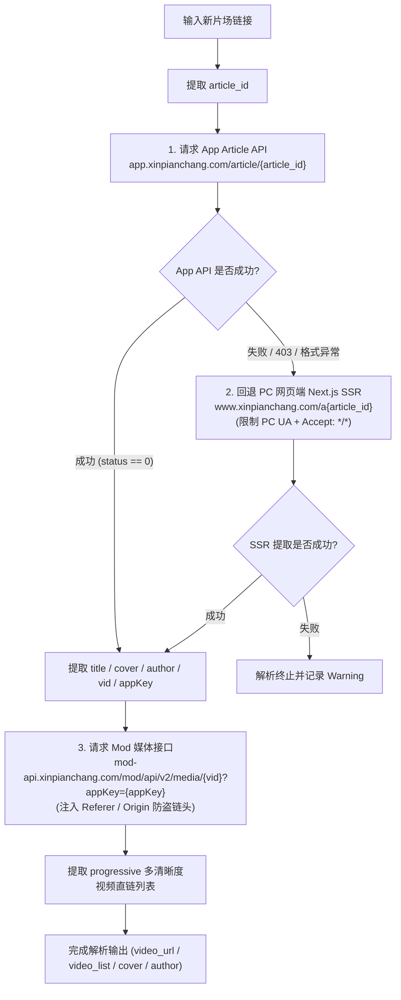

# 新片场 (Xinpianchang) 逆向解析指南

本篇详细记录影视创作人社区 **新片场** 4K/1080P 高清影视作品的抓取方案、App API 与 Web SSR 双轨容灾机制、防盗链请求头及踩坑经验。

---

## 1. 平台特征与支持能力

* **平台标识**：`新片场`
* **支持媒体类型**：
  * 原画/多清晰度渐进式视频流列表 (`video_list`，包含 4K/1080P/720P 等多码率 MP4 直链)
  * 首选播放直链 (`video_url` 取最高清可用直链)
  * 作品静态高清封面 (`cover_url`)
  * 创作人信息 (昵称 `nickname`、主页 ID `author_id`、头像 `avatar`)
* **常见链接形态**：
  * 网页链接：`https://www.xinpianchang.com/a13792376`
  * 网页带参数分享链：`https://www.xinpianchang.com/a11812492?from=webShare&channel=copyLink`
* **Cookie 依赖**：无需 Cookie（公开作品 100% 免登解析）。

---

## 2. 链路追踪与 ID 提取

1. **302 重定向**：通过 `WebFetcher.fetch_redirect_url` 跟随短链跳转至标准长链接。
2. **Article ID 提取**：
   * 优先正则匹配 `/a(?P<id>\d+)`；
   * 其次匹配 query 参数 `article_id=(\d+)`；
   * 若均为非标准路径，从 path 纯数字段正则回退匹配 `\d{5,}` 提取作品数字 ID。

---

## 3. 核心逆向方案与双轨容灾架构

新片场解析采用 **App 移动端 Article API 主路径 + PC 网页端 Next.js SSR `__NEXT_DATA__` 兜底路径 + Mod 媒体播放器接口** 的双轨高可用架构。



### 3.1 App 核心文章接口（主路径）
* **接口端点**：
  ```text
  GET https://app.xinpianchang.com/article/{article_id}
  ```
* **请求头**：携带移动端 User-Agent 与 `Accept: application/json, text/plain, */*`。
* **数据结构**：返回 JSON 中 `data` 节点包含：
  * `title`：作品标题；
  * `cover`：封面图片 URL；
  * `author.userinfo`：创作者信息（`id`, `username`, `avatar`）；
  * `vid` / `media_id` / `video.vid`：底层视频媒体 ID；
  * `video.appKey`：视频媒体鉴权 Key（若缺失则使用内置默认 Key `61a2f329348b3bf77` 兜底）。

### 3.2 网页端 Next.js SSR `__NEXT_DATA__` 提取（容灾降级路径）
当 App 接口因 IP 限流、云服务器出口封锁或返回非 200 时，自动回退到网页端 SSR 解析：
* **目标地址**：`https://www.xinpianchang.com/a{article_id}`
* **关键请求要求**：
  * 必须使用 **PC 端 User-Agent**：若使用移动端 UA，服务端会 302 重定向到移动 H5 精简页，页面内不注入 `__NEXT_DATA__`；
  * 请求头必须指定 **`Accept: */*`**：若带浏览器默认的富文本 `text/html,...`，某些 CDN 节点会下发精简版静态 HTML。
* **数据提取**：
  * 正则提取 `<script id="__NEXT_DATA__"[^>]*>(.*?)</script>`；
  * 解析 JSON 中的 `props.pageProps.detail`，该节点数据结构与 App 接口 `data` 保持完全一致，无需额外做字段适配。

### 3.3 Mod 媒体播放器接口提取视频直链
* **接口端点**：
  ```text
  GET https://mod-api.xinpianchang.com/mod/api/v2/media/{vid}?appKey={app_key}
  ```
* **防盗链请求头**：
  * `Referer: https://www.xinpianchang.com/`
  * `Origin: https://www.xinpianchang.com`
* **视频流解析**：
  * 解析 `data.resource.progressive` 数组；
  * 提取所有合法 HTTP/HTTPS 视频流地址；
  * 通过 `dict.fromkeys(urls)` 去重并保持清晰度顺序输出至 `video_list`。

---

## 4. 常见踩坑记录与防盗链 (Gotchas)

1. **移动端 UA 请求网页导致 `__NEXT_DATA__` 丢失**：
   * *现象*：回退到网页端抓取时，若复用移动端 UA 会被自动重定向至移动 H5 页，导致正则查找 `<script id="__NEXT_DATA__">` 失败。
   * *解法*：SSR 回退阶段显式指定 `USER_AGENT_PC`。
2. **`Accept` 请求头引发的 HTML 降级**：
   * *现象*：部分出口节点对带有默认浏览器 `Accept: text/html,application/xhtml+xml...` 的请求返回不含 Next.js 状态数据的空壳。
   * *解法*：在请求 Headers 中明确固定为 `Accept: */*`。
3. **Mod 媒体接口 403 防盗链拦截**：
   * *现象*：请求 `mod-api.xinpianchang.com` 时若缺少来源校验，接口会返回 403 Forbidden。
   * *解法*：在 `media_headers` 中强制注入 `Referer: https://www.xinpianchang.com/` 与 `Origin: https://www.xinpianchang.com`。
4. **App 接口突发异常与无缝故障转移**：
   * *现象*：新片场 App 接口偶尔会对海外机房或高频 IP 响应 403。
   * *解法*：在 `_parse()` 中通过 `self._fetch_article_from_api() or self._fetch_article_from_page()` 优雅短路回退，保障服务 99.9% 以上高可用。

---

## 5. 测试与验证

* **单元测试文件**：[tests/test_xinpianchang_parser.py](file:///Users/leo/Projects/media-parser/tests/test_xinpianchang_parser.py)
* **执行测试**：
  ```bash
  # 运行新片场专项单元测试 (覆盖 App API、SSR 容灾降级、防盗链与无效链接处理)
  python3 -m unittest tests/test_xinpianchang_parser.py
  
  # 运行全量单元测试
  python3 -m unittest discover -s tests
  ```
